<div align="center">

# Fill2SR: Repurposing Inpainting Diffusion Transformers for Real-World Super-Resolution

**ECCV 2026**

[Paper](https://doi.org/10.1007/978-3-032-37556-8_24) · [Project Page](https://xingfu-yi.github.io/Fill2SR/) · [Weights](https://huggingface.co/yixingfu/Fill2SR) · [Local Demo](#gradio-demo)

</div>

Official code for **Fill2SR** (ECCV 2026).

Fill2SR repurposes pretrained inpainting diffusion transformers for real-world super-resolution. The Inpainting-Interface Evidence Adapter (IIEA) introduces low-quality image evidence through the model's native inpainting interface, while RCDT constructs training pairs by transferring real degradation patterns to clean images.

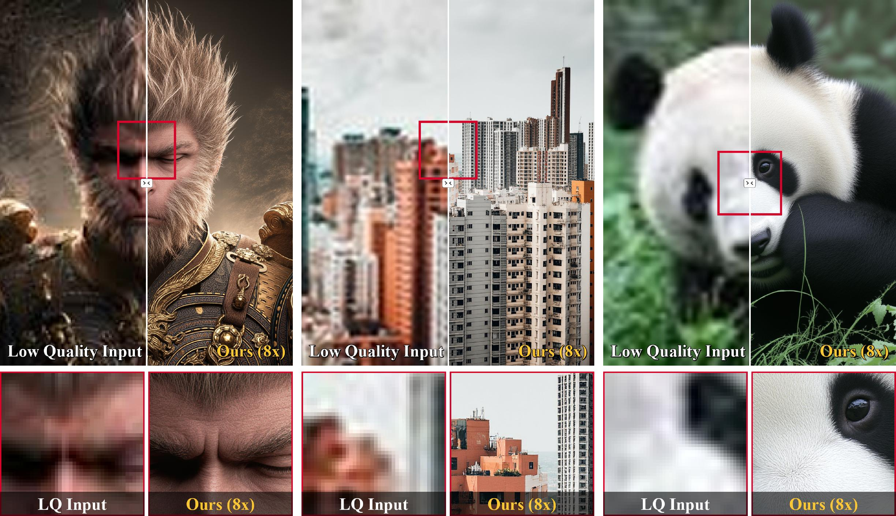

Explore more results with the [interactive comparisons on our project page](https://xingfu-yi.github.io/Fill2SR/#results).

## Installation

Use Python 3.11 or 3.12 and a CUDA GPU. The commands below install PyTorch with CUDA 12.8; choose a compatible PyTorch build for your GPU and driver if needed.

```bash
git clone https://github.com/Xingfu-Yi/Fill2SR.git
cd Fill2SR
python -m venv .venv
source .venv/bin/activate

pip install torch==2.11.0 torchvision==0.26.0 --index-url https://download.pytorch.org/whl/cu128
pip install -r requirements.txt
pip install -e .
```

## Pretrained Models

Download [Fill2SR (Ours-Full)](https://huggingface.co/yixingfu/Fill2SR) and the two base models, [FLUX.1-Fill-dev](https://huggingface.co/black-forest-labs/FLUX.1-Fill-dev) and [FLUX.1-Redux-dev](https://huggingface.co/black-forest-labs/FLUX.1-Redux-dev). Request access where required and accept the model terms on each page. Create a [read access token](https://huggingface.co/settings/tokens), using the same account for model access and CLI login.

```bash
hf auth login
hf auth whoami
hf download black-forest-labs/FLUX.1-Fill-dev --local-dir models/FLUX.1-Fill-dev
hf download black-forest-labs/FLUX.1-Redux-dev --local-dir models/FLUX.1-Redux-dev
hf download yixingfu/Fill2SR sr-full.safetensors --local-dir models
```

<details>
<summary>Alternative: Download from ModelScope</summary>

The same three models are available on ModelScope China: [Fill2SR (Ours-Full)](https://modelscope.cn/models/yixingfu/Fill2SR), [FLUX.1-Fill-dev](https://modelscope.cn/models/black-forest-labs/FLUX.1-Fill-dev) and [FLUX.1-Redux-dev](https://modelscope.cn/models/black-forest-labs/FLUX.1-Redux-dev).

Use a ModelScope China account, accept the model terms and request access where required. Log in with an access token issued by **modelscope.cn**.

```bash
python -m pip install modelscope-hub==0.4.0
ms-hub --endpoint https://modelscope.cn login
ms-hub --endpoint https://modelscope.cn whoami
ms-hub --endpoint https://modelscope.cn download black-forest-labs/FLUX.1-Fill-dev --local-dir models/FLUX.1-Fill-dev
ms-hub --endpoint https://modelscope.cn download black-forest-labs/FLUX.1-Redux-dev --local-dir models/FLUX.1-Redux-dev
ms-hub --endpoint https://modelscope.cn download yixingfu/Fill2SR sr-full.safetensors --local-dir models
```

Both download methods use the directory layout below and the same inference commands. The [ModelScope International mirror](https://modelscope.ai/models/yixingfu/Fill2SR) also hosts the same Fill2SR checkpoint.

</details>

```text
models/
├── FLUX.1-Fill-dev/
├── FLUX.1-Redux-dev/
└── sr-full.safetensors
```

## Inference

Run the bundled Nokia example with the same settings as the Gradio demo:

```bash
python scripts/infer.py \
  --input assets/examples/reallq250/113.png \
  --output outputs/nokia_2k.png \
  --resolution 2k --steps 28 --seed 2026 --offload
```

Replace `--resolution 2k` with `--scale 4` for 4× super-resolution. Resolution presets preserve the input aspect ratio: the 2K preset produces a 1,536 × 1,536 image for this 256 × 256 input. `--offload` reduces GPU memory usage at the cost of speed.

See the [inference guide](docs/inference.md) for output sizes, GPU selection and custom model paths.

### Gradio Demo

```bash
python scripts/app.py --offload
```

Open [http://127.0.0.1:7860](http://127.0.0.1:7860) to try the RealLQ250 examples, compare input and output, and download restored images. The default settings are **2K, 28 steps, seed 2026**.

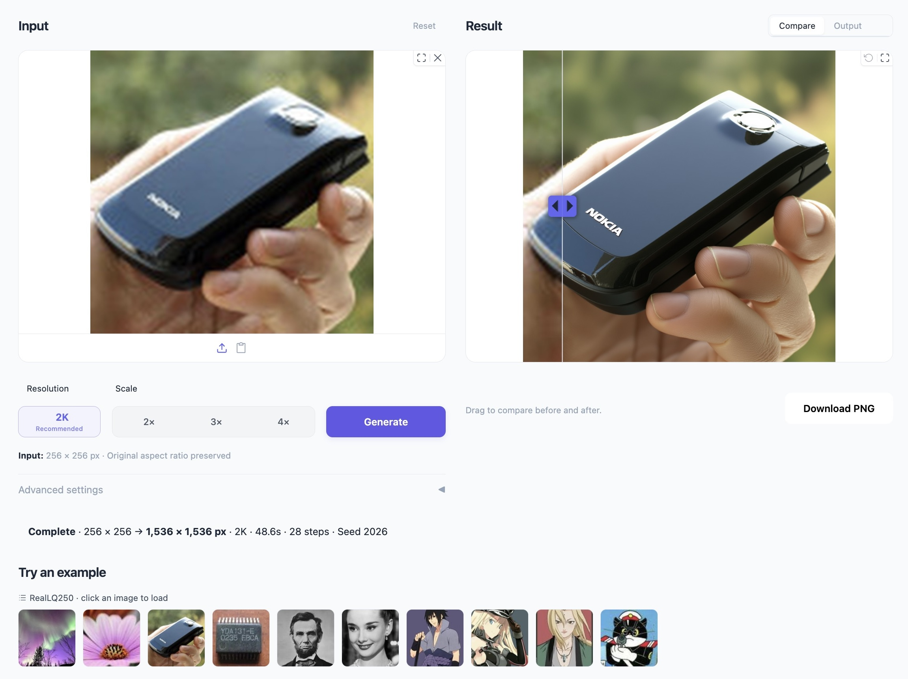

### Batch Inference

```bash
python scripts/evaluate.py \
  --input-dir path/to/LQ \
  --output-dir outputs/benchmark \
  --scale 2 --offload
```

This generates PNG predictions for a directory of images. Choose the scale required by your dataset's evaluation protocol and compute metrics separately. See the [batch options](docs/inference.md#batch-inference) for resolution presets and input validation.

## Results

Qualitative results from the paper and appendix are shown below. Visit the [project page](https://xingfu-yi.github.io/Fill2SR/#comparisons) to view the figures at full width.

### Real-World Super-Resolution

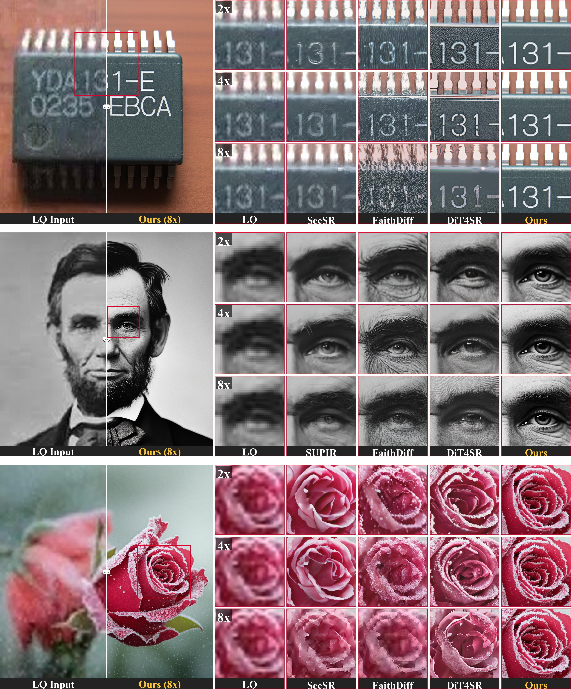

**Fig. A3 — Portrait, electronics, bridge and architecture.** [PDF](results/full_vs_grid_page1.pdf)

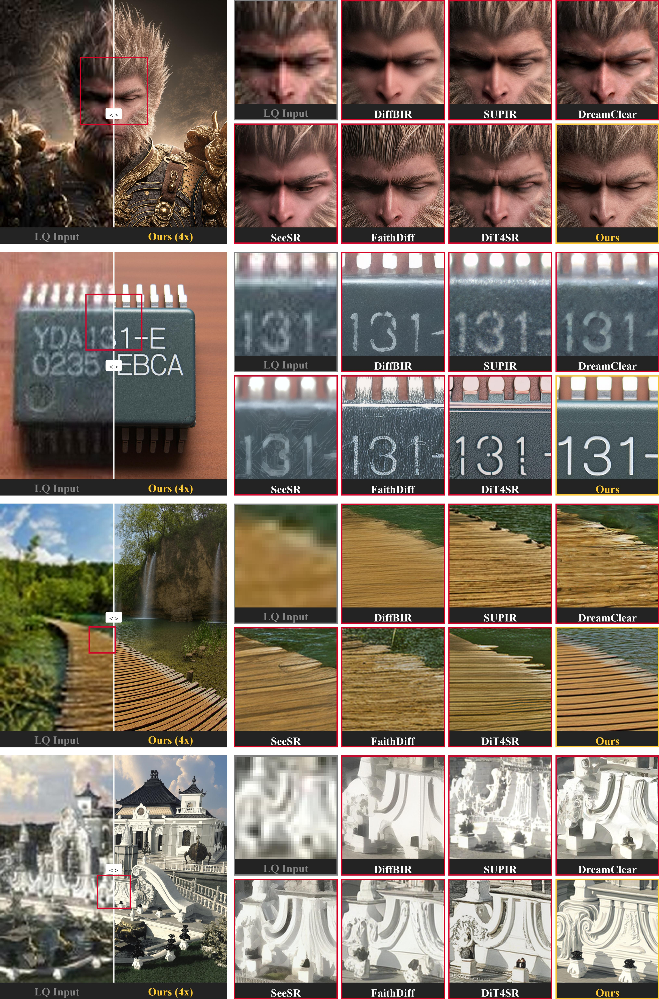

**Fig. A4 — Buildings, faces, aircraft and vehicles.** [PDF](results/full_vs_grid_page2.pdf)

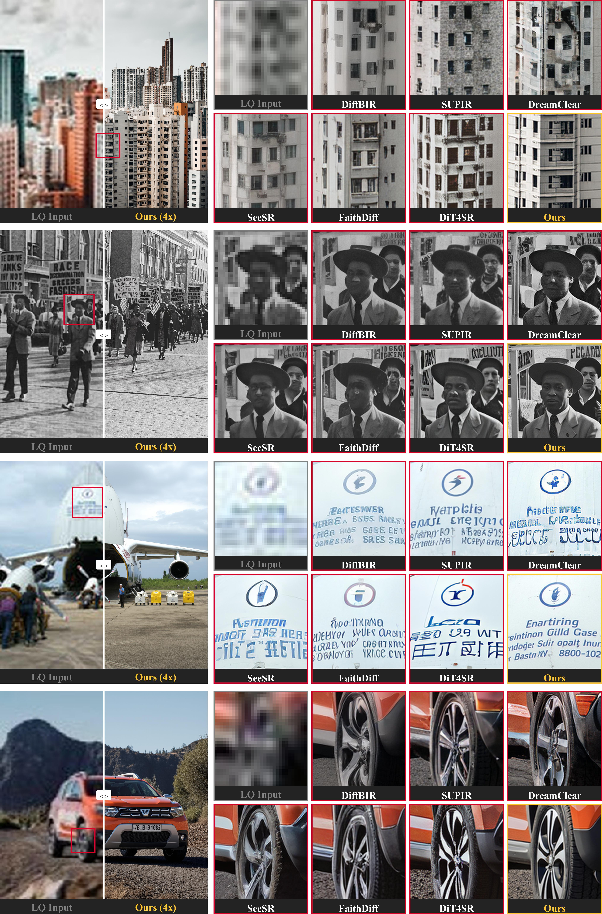

**Fig. A5 — Bus text, panda, illustration and Nokia.** [PDF](results/full_vs_grid_page4.pdf)

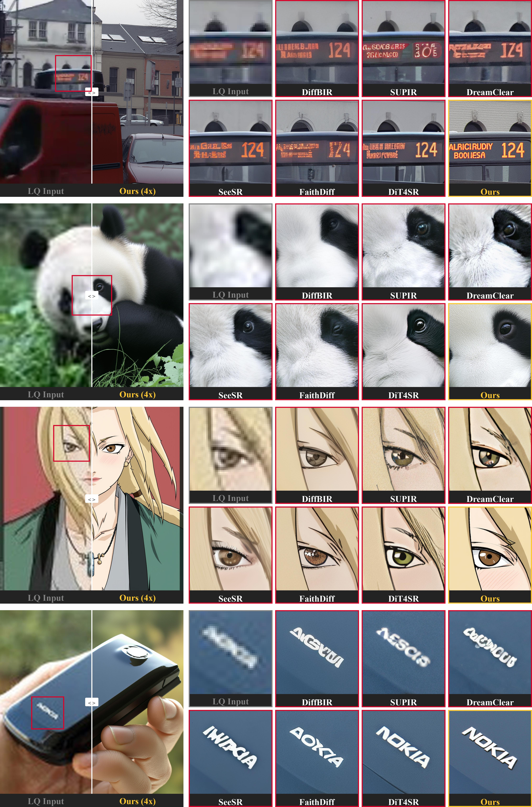

<details>
<summary>More real-world comparisons (Figs. A6–A7)</summary>

**Fig. A6 — Portrait, cat, bicycle and illustration.** [PDF](results/full_vs_grid_page5.pdf)


**Fig. A7 — Cartoon, banner, rose and skateboard.** [PDF](results/full_vs_grid_page6.pdf)

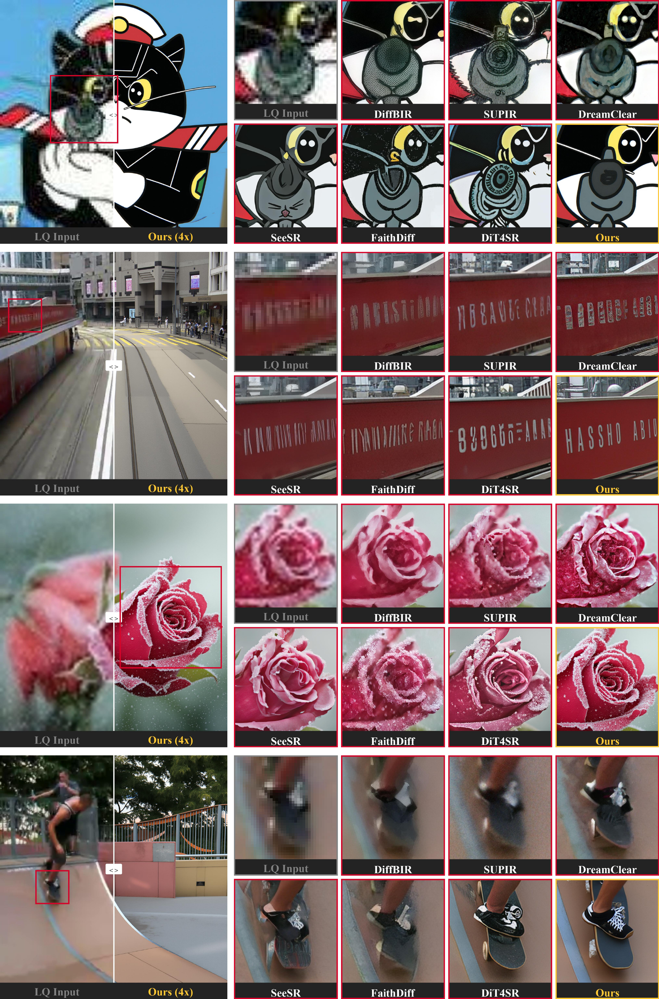

</details>

### Synthetic Degradations


<details>
<summary>12K-scale artwork restoration</summary>

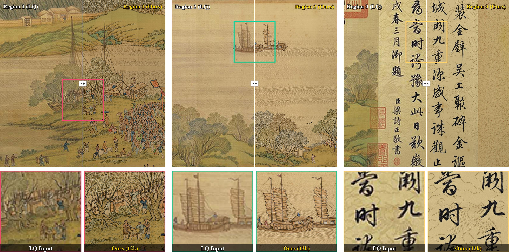

</details>

<details>
<summary>RCDT data synthesis</summary>

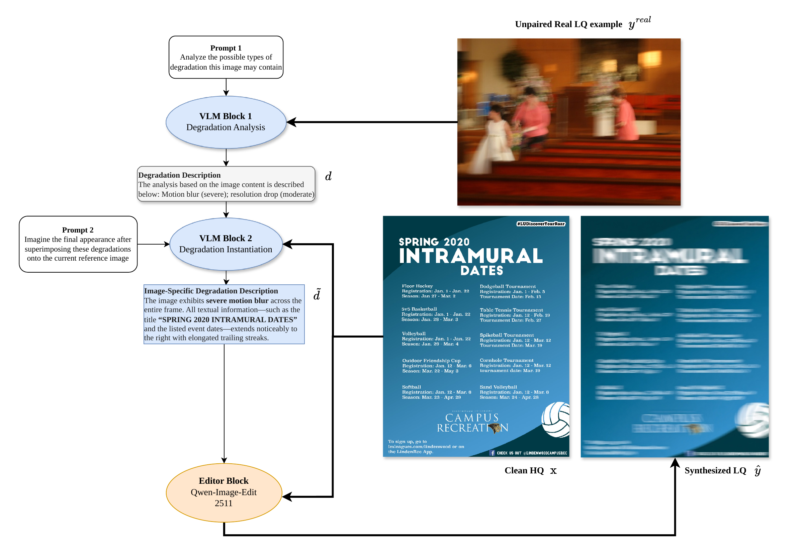

[Original PDF](results/RCDT_optimized.pdf)

</details>

<details>
<summary>Detail studies and ablations</summary>

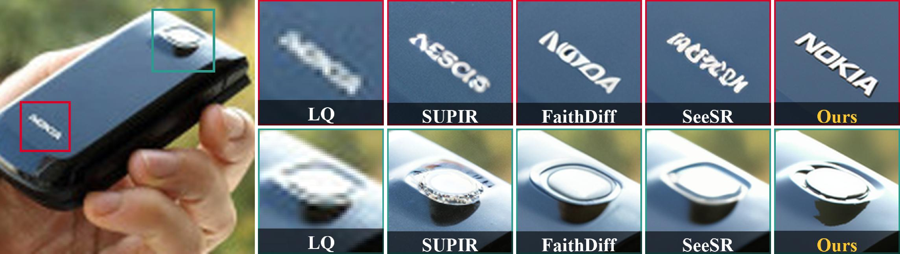

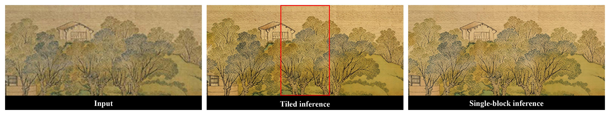

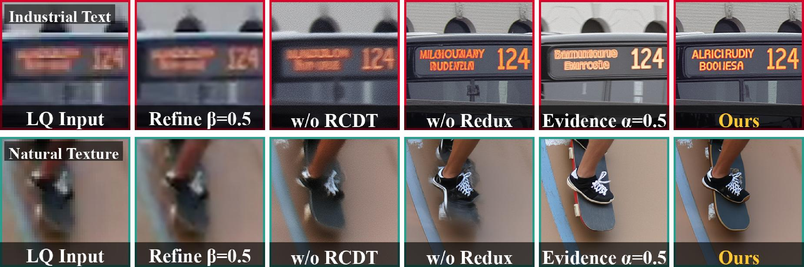

</details>

## Citation

If you find Fill2SR useful in your research, please cite:

```bibtex
@inproceedings{yi2026fill2sr,
  author={Yi, Xingfu and Yu, Xiaoxue},
  title={{Fill2SR}: Repurposing Inpainting Diffusion Transformers for Real-World Super-Resolution},
  booktitle={Computer Vision -- ECCV 2026},
  year={2026},
  doi={10.1007/978-3-032-37556-8_24}
}
```

## Acknowledgements

We thank [Black Forest Labs](https://huggingface.co/black-forest-labs) for FLUX.1-Fill-dev and FLUX.1-Redux-dev, and the [Diffusers](https://github.com/huggingface/diffusers) team for their open-source tools. The RealLQ250 examples come from [DreamClear](https://github.com/shallowdream204/DreamClear); image rights remain with their respective owners. Interactive examples show generated restorations; their image IDs and inference settings are recorded in the [showcase manifest](docs/gallery.json).

## License and Attribution

The repository's original inference code is released under [Apache-2.0](LICENSE). The Ours-Full LoRA is a derivative of Black Forest Labs' FLUX.1 [dev] models and is governed by the [FLUX.1 [dev] Non-Commercial License](https://huggingface.co/yixingfu/Fill2SR/blob/main/LICENSE.md), including its non-commercial and non-production restrictions. Read the [Fill-dev](https://huggingface.co/black-forest-labs/FLUX.1-Fill-dev) and [Redux-dev](https://huggingface.co/black-forest-labs/FLUX.1-Redux-dev) licenses before use. The model repository includes the upstream license and required attribution. Fill2SR is an independent research release and is not an official Black Forest Labs product.

Contact: [yixingfu.research@gmail.com](mailto:yixingfu.research@gmail.com).
